<!-- Generated by scripts/render_svg_cards.py --write-readme -->

<picture><source media="(max-width: 680px)" srcset="./cards/hero-mobile.svg"></picture>

<a href="https://github.com/aymanbouanouj/aymanbouanouj/tree/profile-live/cards"><picture><source media="(max-width: 680px)" srcset="https://raw.githubusercontent.com/aymanbouanouj/aymanbouanouj/profile-live/cards/metrics-mobile.svg"></picture></a>

<a href="https://github.com/aymanbouanouj"><picture><source media="(max-width: 680px)" srcset="./cards/calendar-mobile.svg">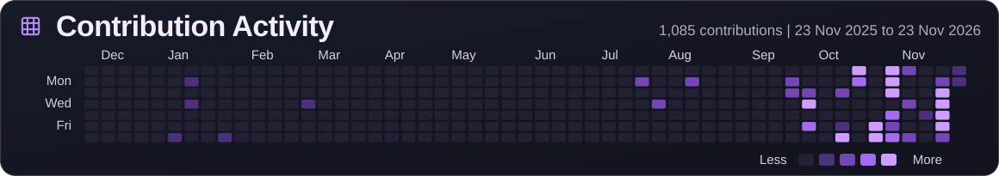</picture></a>

<picture><source media="(max-width: 680px)" srcset="./cards/technical-mobile.svg">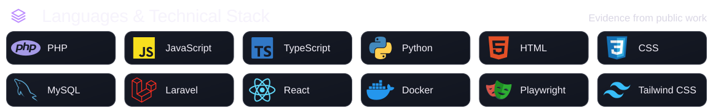</picture>

<picture><source media="(max-width: 680px)" srcset="./cards/tools-mobile.svg">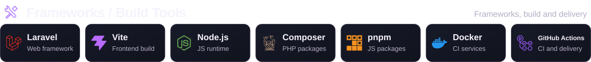</picture>

<picture><source media="(max-width: 680px)" srcset="./cards/heading-featured-mobile.svg"></picture>
 

<a href="https://github.com/aymanbouanouj/morocco2030"></a>

 

<a href="https://aymanbouanouj.github.io/ab-train-ticket-studio/">AB Train Ticket Studio live demo ↗</a>

<picture><source media="(max-width: 680px)" srcset="./cards/heading-opensource-mobile.svg"></picture>
 

<a href="https://github.com/Egonex-AI/Understand-Anything/pull/794"><picture><source media="(max-width: 680px)" srcset="https://raw.githubusercontent.com/aymanbouanouj/aymanbouanouj/profile-live/cards/contribution-794-mobile.svg">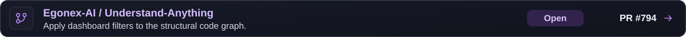</picture></a> 
<a href="https://github.com/OWASP/CheatSheetSeries/issues/2792#issuecomment-6633108162"><picture><source media="(max-width: 680px)" srcset="https://raw.githubusercontent.com/aymanbouanouj/aymanbouanouj/profile-live/cards/contribution-2792-mobile.svg">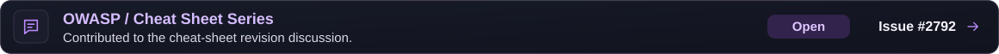</picture></a> 
<a href="https://github.com/php/doc-en/pull/5930"><picture><source media="(max-width: 680px)" srcset="https://raw.githubusercontent.com/aymanbouanouj/aymanbouanouj/profile-live/cards/contribution-5930-mobile.svg">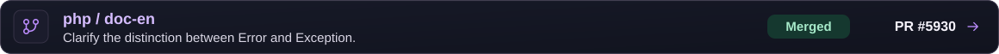</picture></a>

<picture><source media="(max-width: 680px)" srcset="./cards/heading-building-mobile.svg"></picture>
 

<picture><source media="(max-width: 680px)" srcset="./cards/heading-pinned-mobile.svg"></picture>
 

<a href="https://github.com/aymanbouanouj/morocco2030">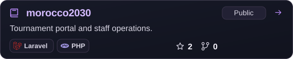</a>
<a href="https://github.com/aymanbouanouj/ab-train-ticket-studio">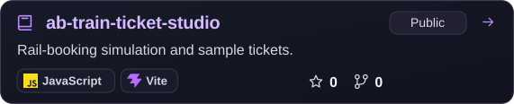</a> 
<a href="https://github.com/aymanbouanouj/PC-Full-Check">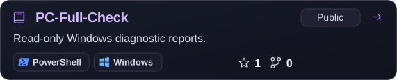</a>

Profile text and data sources

<strong>Ayman Bounaouj</strong> · Full-Stack Web Developer. Building practical, secure and scalable digital products.

<ul>
<li><a href="https://github.com/aymanbouanouj/morocco2030">Morocco2030</a>. Independent academic portal for multilingual tournament information and role-based staff workflows. <a href="https://github.com/aymanbouanouj/morocco2030/releases">Releases</a> · <a href="https://github.com/aymanbouanouj/morocco2030/actions/workflows/ci.yml">CI</a></li>
<li><a href="https://github.com/aymanbouanouj/ab-train-ticket-studio">AB Train Ticket Studio</a>. Independent booking simulation with sample tickets. <a href="https://aymanbouanouj.github.io/ab-train-ticket-studio/">Live demo</a></li>
<li><a href="https://github.com/aymanbouanouj/PC-Full-Check">PC Full Check</a>. Read-only Windows diagnostics and local reports. <a href="https://github.com/aymanbouanouj/PC-Full-Check/tree/main/tests">Tests</a></li>
<li><a href="https://github.com/aymanbouanouj/violetgate">VioletGate</a>. Authentication UI demo. <a href="https://aymanbouanouj.github.io/violetgate/">Live demo</a> · <a href="https://github.com/aymanbouanouj/ayman-calc">Ayman Calc</a>. Browser calculator. <a href="https://aymanbouanouj.github.io/ayman-calc/">Live demo</a></li>
</ul>

GitHub GraphQL supplies the <a href="https://github.com/aymanbouanouj/aymanbouanouj/blob/profile-live/cards/contributions.json">daily counts</a>. GitHub REST supplies repository totals and the <a href="https://github.com/search?q=is%3Apr+is%3Amerged+is%3Apublic+author%3Aaymanbouanouj&amp;type=pullrequests">merged public PR search</a>. <a href="https://github.com/aymanbouanouj">GitHub’s native contribution graph</a> shows current activity.

<a href="./docs/DASHBOARD.md">Technical evidence and refresh setup</a> · <a href="./PROFILE-V5.md">Original artwork and previous profile links</a>

© 2026 Ayman Bounaouj. Original AB branding. All rights reserved.

