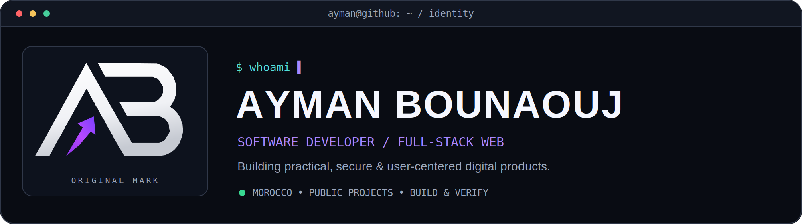
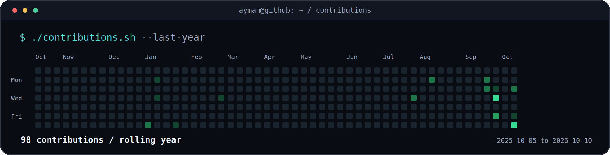
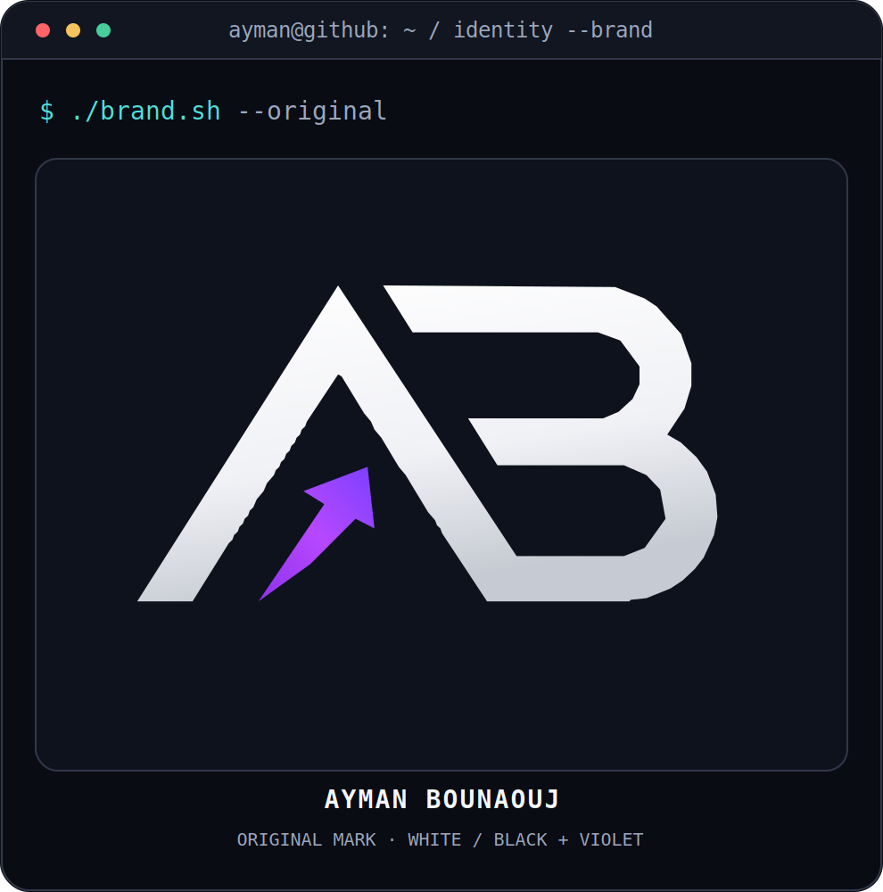
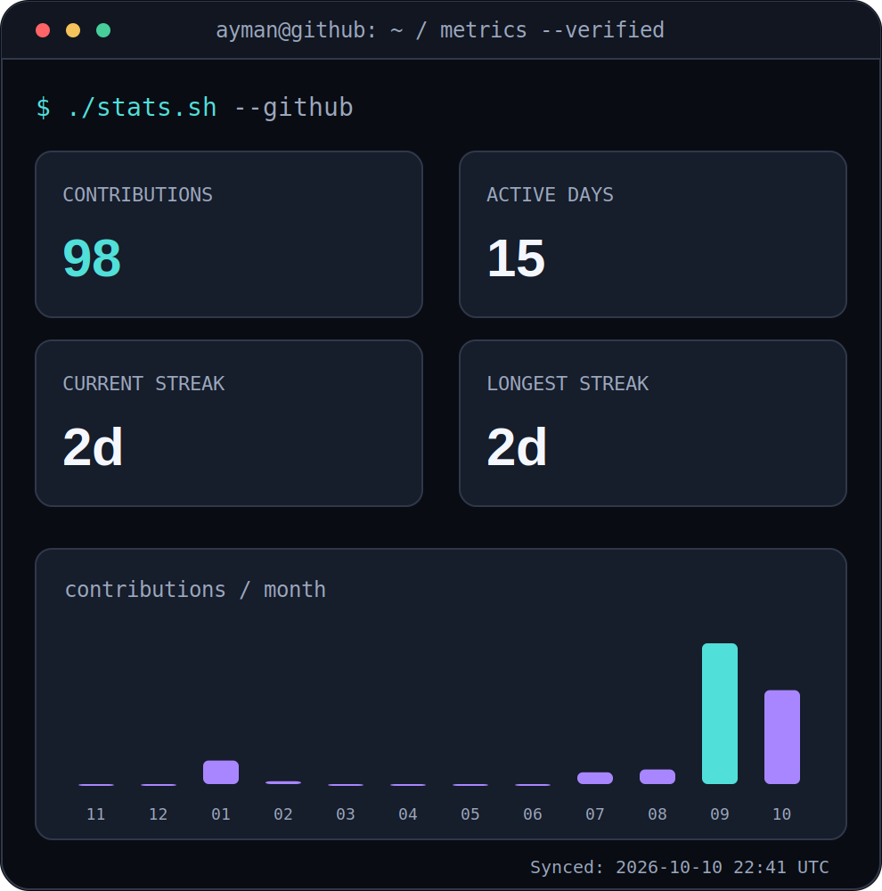
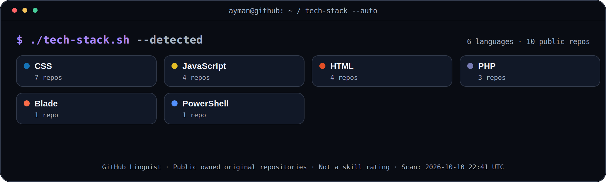
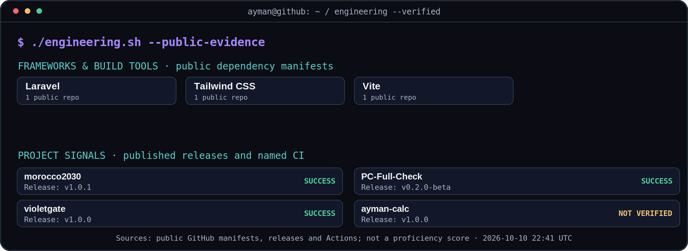

<!-- Original Ayman Bounaouj profile. All graphics are local, no external counters. -->

<h3><code>ayman@github ~ $ whoami</code></h3>

<h3><code>ayman@github ~ $ ./contributions.sh</code></h3>

<h3><code>ayman@github ~ $ ./identity-and-stats.sh</code></h3>

<h3><code>ayman@github ~ $ ./tech-stack.sh --auto</code></h3>

Automatically detected using GitHub Linguist from public, non-fork, non-archived repositories. The scan updates every 6 hours; languages are evidence of code presence, not proficiency.

<h3><code>ayman@github ~ $ ./engineering.sh --verified</code></h3>

Evidence from public dependency manifests, release tags and named GitHub Actions. Details link to the underlying repositories below; these are not skill ratings.

<h3><code>ayman@github ~ $ ./featured-project.sh</code></h3>

<b><a href="https://github.com/aymanbouanouj/morocco2030">Morocco2030 — Independent Laravel Engineering Project</a></b>

Multilingual tournament portal and staff back office with role-based access. Independent academic project, <b>not FIFA-affiliated</b>.

<a href="https://github.com/aymanbouanouj/morocco2030">Source code</a> · <a href="https://github.com/aymanbouanouj/morocco2030/actions/workflows/ci.yml">CI evidence</a> · <a href="https://github.com/aymanbouanouj/morocco2030/releases">Published releases</a>

Only demonstrated public project evidence is shown; no invented traffic, users or security certifications.

<h3><code>ayman@github ~ $ ./proof-of-work.sh</code></h3>

#### [Morocco2030 ↗](https://github.com/aymanbouanouj/morocco2030)
`Laravel 12` · `RBAC` · `Multilingual`

Independent academic project: tournament portal and role-based back office. **Not affiliated with FIFA.** [Source code](https://github.com/aymanbouanouj/morocco2030) · [CI workflow](https://github.com/aymanbouanouj/morocco2030/actions/workflows/ci.yml)

---

#### [PC Full Check ↗](https://github.com/aymanbouanouj/PC-Full-Check)
`PowerShell` · `Windows 10/11` · `Privacy-first`

Read-only Windows diagnostics with local reports. [Source code](https://github.com/aymanbouanouj/PC-Full-Check) · [Test scripts](https://github.com/aymanbouanouj/PC-Full-Check/tree/main/tests)

---

#### [VioletGate ↗](https://github.com/aymanbouanouj/violetgate)
`HTML` · `CSS` · `JavaScript`

Responsive sign-in/sign-up **frontend demo only (no real authentication)**. [Live demo](https://aymanbouanouj.github.io/violetgate/) · [Quality checks](https://github.com/aymanbouanouj/violetgate/actions/workflows/quality.yml)

---

#### [Ayman Calc ↗](https://github.com/aymanbouanouj/ayman-calc)
`Vanilla JavaScript` · `Responsive UI`

Calculator with keyboard controls and history. [Live demo](https://aymanbouanouj.github.io/ayman-calc/) · [Source code](https://github.com/aymanbouanouj/ayman-calc)

---

### Open-Source Contributions

**[SGA-BTS — merged documentation improvement ↗](https://github.com/HichamFaska/SGA-BTS/pull/1)**

Improved project documentation and local setup instructions in another maintainer's repository. Scope: **documentation**, not an unsupported claim about feature development.

---

<h3><code>ayman@github ~ $ ./connect.sh</code></h3>

<b>Full-Stack Web Development · Practical Engineering · Public Projects</b>

Original SVG artwork · Projects link to public code and demos · GitHub calendar activity may exclude private contributions · Last sync shown in statistics.

Original scalable SVGs: <a href="./assets/hero-dark.svg">Hero</a> · <a href="./assets/contributions-dark.svg">Contributions</a> · <a href="./assets/logo-dark.svg">Logo</a> · <a href="./assets/stats-dark.svg">Stats</a> · <a href="./assets/tech-stack-dark.svg">Tech-Stack</a> · <a href="./assets/engineering-dark.svg">Engineering</a>. PNG previews ensure mobile-app compatibility.

