<!-- AB Studio · verified data · native links, minimal visible imagery -->

<strong>Contribution calendar</strong> — dated automatic visualization

<h3><code>ayman@github ~ $ ./contributions.sh</code></h3>

The native GitHub contribution graph below this README is authoritative. This historical snapshot is not a live counter.

<h3><code>ayman@github ~ $ whoami</code></h3>

<table>
<tr>
<td width="50%" align="center" valign="top">

</td>
<td width="50%" align="center" valign="top">

</td>
</tr>
</table>

### Full-Stack Web Developer · Laravel · PHP · JavaScript

*Practical, secure and user-centered web applications.*

Développeur web full stack — applications pratiques, sécurisées et centrées utilisateur.

<h3><code>ayman@github ~ $ ./links.sh</code></h3>

[**GitHub**](https://github.com/aymanbouanouj) · [**LinkedIn**](https://www.linkedin.com/in/aymanbounaouj/) · [**Instagram**](https://www.instagram.com/aymanbounaouj/) · [**Facebook**](https://www.facebook.com/AymanBounaouj.dev/)

[**X**](https://x.com/aymanbounaouj) · [**Medium**](https://medium.com/@aymanbounaouj) · [**Beacons**](https://beacons.ai/aymanbounaouj)

---

## Languages & Technical Stack

**◈ Languages · ◇ Frameworks · ⌘ Tools**

[**Live verified technology inventory ↗**](https://github.com/aymanbouanouj/aymanbouanouj/blob/profile-live/live/portfolio.md) · [Explore current public code ↗](https://github.com/aymanbouanouj?tab=repositories)

Langages détectés par GitHub Linguist dans les dépôts publics personnels. Frameworks require public manifest evidence. Clickable names and source links are regenerated hourly (best effort) in the linked Markdown inventory. GitHub README cannot embed remote Markdown or run JavaScript. Byte percentages reflect code presence, not proficiency.

## Featured Projects

#### [01 — Morocco2030 ↗](https://github.com/aymanbouanouj/morocco2030)
**Laravel 12 · RBAC · Multilingual portal** — Independent academic project: tournament information and staff back office, not affiliated with FIFA. [Code](https://github.com/aymanbouanouj/morocco2030) · [CI](https://github.com/aymanbouanouj/morocco2030/actions/workflows/ci.yml) · [Releases](https://github.com/aymanbouanouj/morocco2030/releases)

#### [02 — PC Full Check ↗](https://github.com/aymanbouanouj/PC-Full-Check)
**PowerShell · Windows 10/11** — Read-only, privacy-first PC diagnostics. [Code](https://github.com/aymanbouanouj/PC-Full-Check) · [Tests](https://github.com/aymanbouanouj/PC-Full-Check/tree/main/tests)

#### [03 — VioletGate ↗](https://github.com/aymanbouanouj/violetgate)
**HTML · CSS · JavaScript** — Responsive authentication UI demo, not a real authentication backend. [Live demo](https://aymanbouanouj.github.io/violetgate/) · [Code](https://github.com/aymanbouanouj/violetgate)

#### [04 — Ayman Calc ↗](https://github.com/aymanbouanouj/ayman-calc)
**JavaScript** — Responsive calculator with keyboard controls and history. [Live demo](https://aymanbouanouj.github.io/ayman-calc/) · [Code](https://github.com/aymanbouanouj/ayman-calc)

Résumé des projets en français

Projet académique indépendant : Morocco2030 est un portail multilingue sans affiliation à la FIFA. PC Full Check offre des diagnostics Windows en lecture seule. VioletGate est une démonstration sans authentification réelle. Ayman Calc est une calculatrice JavaScript responsive.

## Other Projects & Open Source

[**Other public projects — auto-updated ↗**](https://github.com/aymanbouanouj/aymanbouanouj/blob/profile-live/live/portfolio.md#other-public-projects) · [All GitHub repositories ↗](https://github.com/aymanbouanouj?tab=repositories)

**Contributions open source:** [SGA-BTS — merged documentation PR #1 ↗](https://github.com/HichamFaska/SGA-BTS/pull/1) — accepted documentation and setup work in an external repository.

[**Verified external PRs — auto-updated ↗**](https://github.com/aymanbouanouj/aymanbouanouj/blob/profile-live/live/portfolio.md#verified-external-contributions) · [GitHub PR activity ↗](https://github.com/pulls?q=is%3Apr+is%3Amerged+author%3Aaymanbouanouj)

<strong>Current public activity — automatically refreshed</strong>

## Current public activity — automatically refreshed

[Public repositories ↗](https://github.com/aymanbouanouj?tab=repositories) · [Generated data provenance ↗](https://github.com/aymanbouanouj/aymanbouanouj/tree/profile-live/live)

Hourly checks (best effort) and refreshes after relevant protected-main updates. Snapshots are not a live counter and GitHub images may be cached. GitHub native activity remains authoritative.

<strong>Historical design gallery &amp; original AB artwork</strong>

## Original AB artwork and open-source work

<h3><code>ayman@github ~ $ ./identity-and-stats.sh</code></h3>

Archived GraphQL data may contain aggregate private contributions without revealing private repositories. GitHub Actions checks approximately every six hours, but reviewed updates of this historical artwork still require an approved Pull Request (scheduled writes require explicit opt-in).

Original SVGs: [Hero](./assets/hero-dark.svg) · [Contributions](./assets/contributions-dark.svg) · [Logo](./assets/logo-dark.svg) · [Stats](./assets/stats-dark.svg) · [Tech Stack](./assets/tech-stack-dark.svg) · [Engineering](./assets/engineering-dark.svg).

Archived badge designs (not displayed as images): [LinkedIn](./assets/link-linkedin.svg) · [Instagram](./assets/link-instagram.svg) · [Facebook](./assets/link-facebook.svg) · [X](./assets/link-x.svg) · [Medium](./assets/link-medium.svg) · [Beacons](./assets/link-profiles.svg).

---

Original SVG artwork · Projects link to public code and demos · GitHub-verified public data · No fabricated counters or third-party tracking images.

© 2026 Ayman Bounaouj. All rights reserved. Original branding and artwork are not licensed for reuse.

© 2026 Ayman Bounaouj. Tous droits réservés. Identité visuelle originale non autorisée à la réutilisation.

