<!-- Profile V6 · Screenshot-inspired presentation with verified auto-refresh -->

<a href="https://github.com/aymanbouanouj/portfolio-ayman">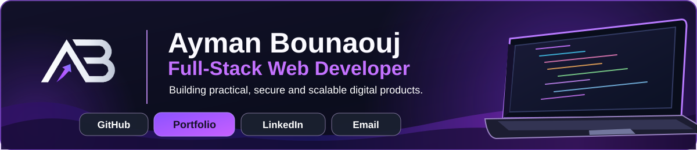</a>

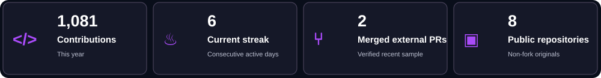

Metrics are dated verified GitHub snapshots, never copied from the visual mockup. Merged PRs count a recent independently verified sample, not a lifetime total. GitHub Actions refresh is best-effort, not real-time.

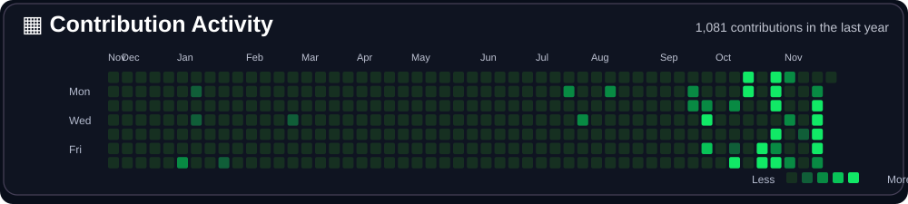

[View current GitHub activity](https://github.com/aymanbouanouj). GitHub's native contribution graph remains authoritative; image cache delays are possible.

## Languages & Technical Stack

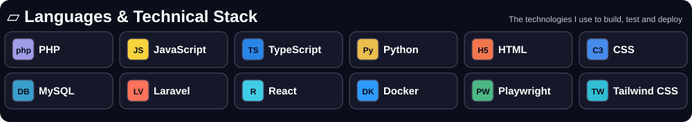

[Verified GitHub Linguist language shares](https://github.com/aymanbouanouj/aymanbouanouj/blob/profile-live/live/portfolio.md#programming-languages) are code-byte percentages, not proficiency ratings. Authorized private repository bytes are aggregated without publishing private metadata.

## Frameworks / Build Tools

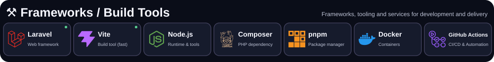

[Public dependency-manifest evidence](https://github.com/aymanbouanouj/aymanbouanouj/blob/profile-live/live/portfolio.md#verified-frameworks-and-build-tools) distinguishes verified frameworks from owner-declared tooling.

## Featured Projects

<a href="https://github.com/aymanbouanouj/morocco2030">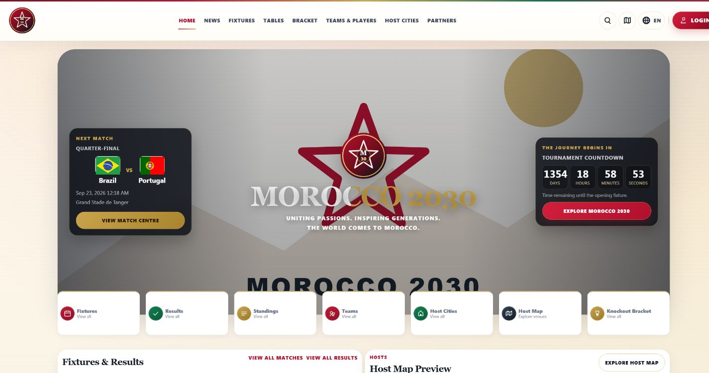</a>
<a href="https://github.com/aymanbouanouj/ab-train-ticket-studio">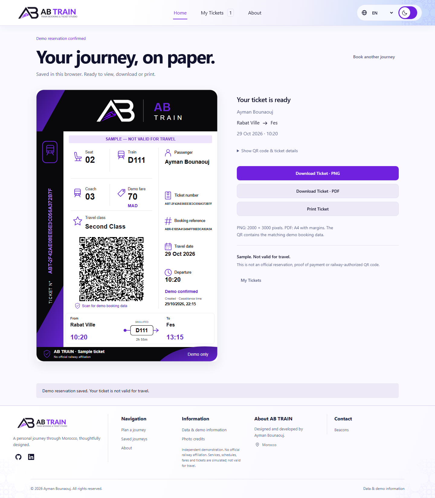</a>
<a href="https://github.com/aymanbouanouj/PC-Full-Check">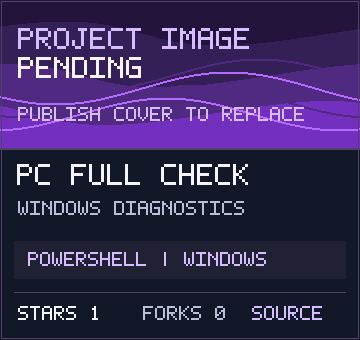</a>

Only published public project images are used. Missing image → styled placeholder; image uploaded later → automatically selected during a successful scheduled refresh. [Image setup instructions](./docs/V6-RELEASE-NOTES.md).

## Open Source & Collaborations

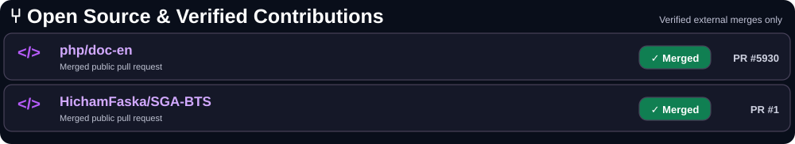

[Verified merged PR sources](https://github.com/aymanbouanouj/aymanbouanouj/blob/profile-live/live/portfolio.md#verified-external-contributions) · [All external pull requests](https://github.com/pulls?q=is%3Apr+author%3Aaymanbouanouj)

## Currently Building

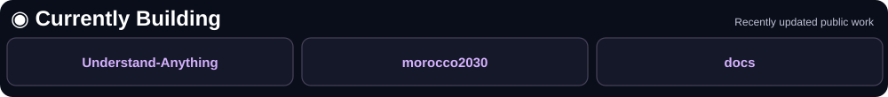

[Browse recent public work](https://github.com/aymanbouanouj?tab=repositories). The cards represent public recently updated repositories, not a real-time coding-status claim.

## Pinned / Selected Repositories

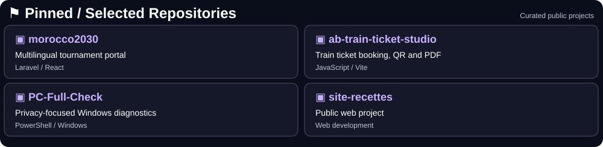

[Morocco2030](https://github.com/aymanbouanouj/morocco2030) · [AB Train Ticket Studio](https://github.com/aymanbouanouj/ab-train-ticket-studio) · [PC Full Check](https://github.com/aymanbouanouj/PC-Full-Check) · [All repositories](https://github.com/aymanbouanouj?tab=repositories)

---


**Build · Learn · Contribute · Automate**

[GitHub](https://github.com/aymanbouanouj) · [LinkedIn](https://www.linkedin.com/in/aymanbounaouj/) · [Portfolio](https://github.com/aymanbouanouj/portfolio-ayman)

© 2026 Ayman Bounaouj. Original AB logo and artwork; all rights reserved.

<strong>Extended verified data, original project details and historical profile panels</strong>

<!-- Profile V6 · editorial, evidence-first presentation · verified data stays on profile-live -->

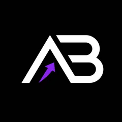

<strong>Building useful web products with clear architecture, thoughtful interfaces and verifiable engineering work.</strong>

<a href="#featured-projects">Featured projects</a> · <a href="#languages--technical-stack">Languages &amp; tools</a> · <a href="#open-source--collaborations">Open source</a>

<h3><code>ayman@github ~ $ ./dashboard.sh --verified</code></h3>

<h3><code>aymanbouanouj@github ~ $ ./contributions.sh</code></h3>

Detailed contribution visualization (original verified chart)


Verified GraphQL data · Updated periodically, subject to GitHub Actions and image cache delays · <a href="https://github.com/aymanbouanouj">View current GitHub activity ↗</a>. GitHub's native contribution graph below is the authoritative activity calendar.

<h3><code>ayman@github ~ $ whoami</code></h3>

<table>
<tr>
<td width="50%" align="center" valign="top">

</td>
<td width="50%" align="center" valign="top">


</td>
</tr>
</table>

### Full-Stack Web Developer · Laravel · PHP · JavaScript

*Laravel/PHP, JavaScript and full-stack delivery — with source code, tests and live demonstrations where available.*

<h3><code>ayman@github ~ $ ./links.sh</code></h3>

Other profiles

## Engineering Focus

**Backend & access control:** Laravel architecture and staff roles in [Morocco2030](https://github.com/aymanbouanouj/morocco2030).  
**Verification & diagnostics:** Read-only Windows diagnostics in [PC Full Check](https://github.com/aymanbouanouj/PC-Full-Check) and browser testing in [AB Train Ticket Studio](https://github.com/aymanbouanouj/ab-train-ticket-studio).  
**Interface delivery:** Responsive [VioletGate](https://aymanbouanouj.github.io/violetgate/) and [Ayman Calc](https://aymanbouanouj.github.io/ayman-calc/) demonstrations.

---

## Languages & Technical Stack

**Languages / Frameworks / Build Tools**

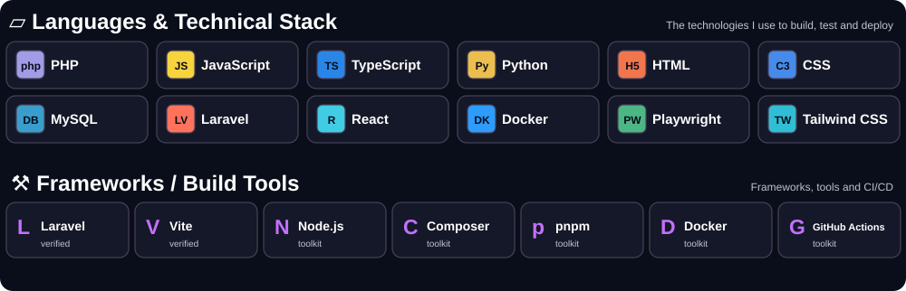

Extended verified language and framework inventory

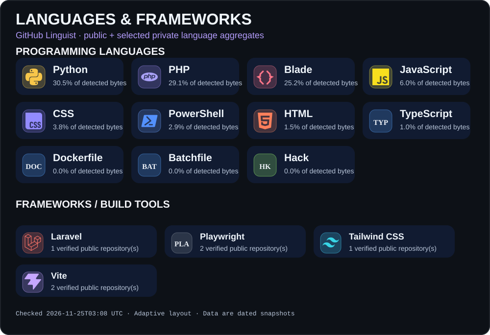

Language proportions use GitHub Linguist code bytes, not skill ratings. Aggregated private-repository language bytes are included only when authorized access is available; private repository names and files are not published. Frameworks require public dependency-manifest evidence. Snapshots refresh hourly on a best-effort basis. [Inspect dated evidence ↗](https://github.com/aymanbouanouj/aymanbouanouj/blob/profile-live/live/portfolio.md).

## Featured Projects

<a href="https://github.com/aymanbouanouj/morocco2030">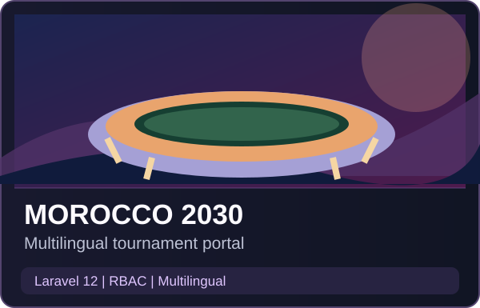</a>

<a href="https://github.com/aymanbouanouj/PC-Full-Check">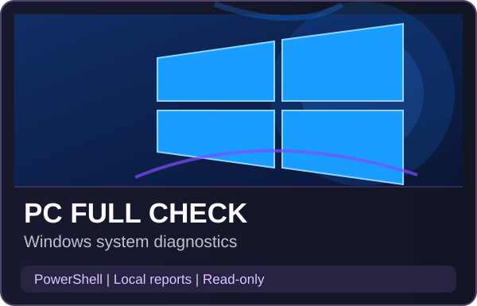</a>

[Morocco2030](https://github.com/aymanbouanouj/morocco2030) · [AB Train Ticket Studio](https://github.com/aymanbouanouj/ab-train-ticket-studio) · [PC Full Check](https://github.com/aymanbouanouj/PC-Full-Check)

#### [01 — Morocco2030 ↗](https://github.com/aymanbouanouj/morocco2030)
**Laravel 12 · RBAC · Multilingual portal.** Independent academic portal featuring tournament information, multilingual content, role-based access control, and staff administration. Not affiliated with FIFA.  
[Source](https://github.com/aymanbouanouj/morocco2030) · [CI](https://github.com/aymanbouanouj/morocco2030/actions/workflows/ci.yml) · [Releases](https://github.com/aymanbouanouj/morocco2030/releases)

#### [02 — PC Full Check ↗](https://github.com/aymanbouanouj/PC-Full-Check)
**PowerShell · Windows 10/11.** PowerShell-based Windows diagnostic tool performing read-only system checks and generating local reports.  
[Source](https://github.com/aymanbouanouj/PC-Full-Check) · [Tests](https://github.com/aymanbouanouj/PC-Full-Check/tree/main/tests)

#### [03 — VioletGate ↗](https://github.com/aymanbouanouj/violetgate)
**HTML · CSS · JavaScript.** Responsive authentication interface demonstrating front-end design and interactions. UI demo only; no production authentication backend.  
[Live demo](https://aymanbouanouj.github.io/violetgate/) · [Source](https://github.com/aymanbouanouj/violetgate)

#### [04 — Ayman Calc ↗](https://github.com/aymanbouanouj/ayman-calc)
**Vanilla JavaScript.** Responsive JavaScript calculator with keyboard support and calculation history.  
[Live demo](https://aymanbouanouj.github.io/ayman-calc/) · [Source](https://github.com/aymanbouanouj/ayman-calc)

## More Public Projects

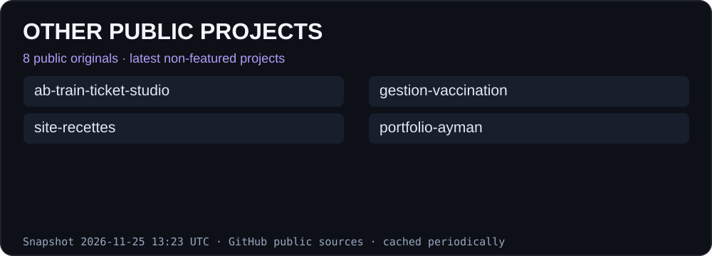

[**Browse all public repositories ↗**](https://github.com/aymanbouanouj?tab=repositories)

## Open Source & Collaborations

Original public contribution evidence chart

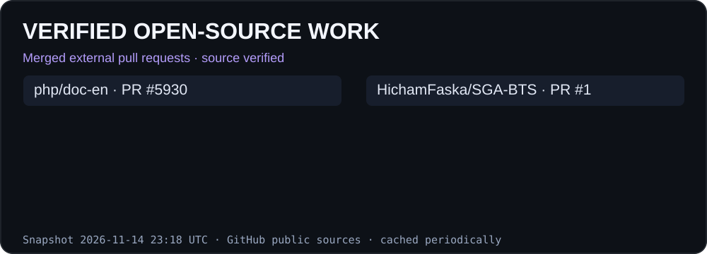

**Open merged contributions:** [PHP Documentation · PR #5930 ↗](https://github.com/php/doc-en/pull/5930) · [SGA-BTS · PR #1 ↗](https://github.com/HichamFaska/SGA-BTS/pull/1)

Explore verified merged pull requests. New contributions are automatically added to the [live contributions index ↗](https://github.com/aymanbouanouj/aymanbouanouj/blob/profile-live/live/portfolio.md#verified-external-contributions). 

<strong>Recent Development Activity</strong>

<a href="https://github.com/aymanbouanouj?tab=repositories"></a>

[Generated JSON evidence ↗](https://github.com/aymanbouanouj/aymanbouanouj/tree/profile-live/live)

Checks scheduled hourly (best-effort) and on relevant profile-code merges; GitHub Actions and image caches may delay visible updates. Does not disclose private repositories or their commit messages. Not a live counter.

<!-- Archived visual comparisons are intentionally kept collapsible; live cards above are the primary view. -->

<strong>Archived Technical Evidence (historical)</strong>

## Archived historical statistics (not live)

<h3><code>ayman@github ~ $ ./identity-and-stats.sh</code></h3>

<h3><code>ayman@github ~ $ ./tech-stack.sh --auto</code></h3>

Previously verified GraphQL snapshots; these are not a live counter. GitHub Actions checks approximately every six hours, but reviewed updates of this historical artwork still require an approved Pull Request (scheduled writes require explicit opt-in). The archived GraphQL calendar may include aggregate private contributions, without identifying private repositories or source code.

<strong>Original Branding &amp; Artwork</strong>

## Original AB artwork and design references

Original scalable artwork: <a href="./assets/hero-dark.svg">Hero</a> · <a href="./assets/logo-dark.svg">Logo</a> · <a href="./assets/contributions-dark.svg">Contributions</a> · <a href="./assets/stats-dark.svg">Statistics</a> · <a href="./assets/tech-stack-dark.svg">Tech Stack</a> · <a href="./assets/engineering-dark.svg">Engineering</a>.

---

Original SVG artwork · Projects link to public code and demos · GitHub-verified public data · Accessible badges · Reviewed automation with required security checks.

© 2026 Ayman Bounaouj. All rights reserved. Original branding and artwork are not licensed for reuse.

