<!-- Original Ayman Bounaouj profile. All graphics are local, no external counters. -->

<h3><code>ayman@github ~ $ whoami</code></h3>
<picture>
  <source media="(prefers-color-scheme: dark)" srcset="./assets/hero-dark.svg" />
  <source media="(prefers-color-scheme: light)" srcset="./assets/hero-light.svg" />
  
</picture>

<h3><code>ayman@github ~ $ ./contributions.sh</code></h3>
<picture>
  <source media="(prefers-color-scheme: dark)" srcset="./assets/contributions-dark.svg" />
  <source media="(prefers-color-scheme: light)" srcset="./assets/contributions-light.svg" />
  
</picture>

<h3><code>ayman@github ~ $ ./identity-and-stats.sh</code></h3>
<table>
  <tr>
    <td width="50%" valign="top">
      <picture>
        <source media="(prefers-color-scheme: dark)" srcset="./assets/logo-dark.svg" />
        <source media="(prefers-color-scheme: light)" srcset="./assets/logo-light.svg" />
        
      </picture>
    </td>
    <td width="50%" valign="top">
      <picture>
        <source media="(prefers-color-scheme: dark)" srcset="./assets/stats-dark.svg" />
        <source media="(prefers-color-scheme: light)" srcset="./assets/stats-light.svg" />
        
      </picture>
    </td>
  </tr>
</table>

<h3><code>ayman@github ~ $ ./proof-of-work.sh</code></h3>

#### [Morocco2030 ↗](https://github.com/aymanbouanouj/morocco2030)
`Laravel 12` · `RBAC` · `Multilingual`

Independent academic project: tournament portal and role-based back office. **Not affiliated with FIFA.** [Source code](https://github.com/aymanbouanouj/morocco2030) · [CI workflow](https://github.com/aymanbouanouj/morocco2030/actions/workflows/ci.yml)

---

#### [PC Full Check ↗](https://github.com/aymanbouanouj/PC-Full-Check)
`PowerShell` · `Windows 10/11` · `Privacy-first`

Read-only Windows diagnostics with local reports. [Source code](https://github.com/aymanbouanouj/PC-Full-Check) · [Test scripts](https://github.com/aymanbouanouj/PC-Full-Check/tree/main/tests)

---

#### [VioletGate ↗](https://github.com/aymanbouanouj/violetgate)
`HTML` · `CSS` · `JavaScript`

Responsive sign-in/sign-up **frontend demo only (no real authentication)**. [Live demo](https://aymanbouanouj.github.io/violetgate/) · [Quality checks](https://github.com/aymanbouanouj/violetgate/actions/workflows/quality.yml)

---

#### [Ayman Calc ↗](https://github.com/aymanbouanouj/ayman-calc)
`Vanilla JavaScript` · `Responsive UI`

Calculator with keyboard controls and history. [Live demo](https://aymanbouanouj.github.io/ayman-calc/) · [Source code](https://github.com/aymanbouanouj/ayman-calc)

---

**Evidence-first profile:** claims link to public repositories or demonstrations. Contribution counts, when available, are GitHub calendar activity, not proof of programming skill. Private contributions may not be included.

<h3><code>ayman@github ~ $ ./connect.sh</code></h3>

<b>Full-Stack Web Development · Practical Engineering · Public Projects</b>

Original SVG artwork · no third-party counter service · statistics display their last synchronization time.

