<!-- Original Ayman Bounaouj profile. All graphics are local, no external counters. -->

<h3><code>ayman@github ~ $ whoami</code></h3>
<picture>
  <source media="(prefers-color-scheme: dark)" srcset="./assets/hero-dark.svg" />
  <source media="(prefers-color-scheme: light)" srcset="./assets/hero-light.svg" />
  
</picture>

<h3><code>ayman@github ~ $ ./contributions.sh</code></h3>
<picture>
  <source media="(prefers-color-scheme: dark)" srcset="./assets/contributions-dark.svg" />
  <source media="(prefers-color-scheme: light)" srcset="./assets/contributions-light.svg" />
  
</picture>

<h3><code>ayman@github ~ $ ./identity-and-stats.sh</code></h3>
<table>
  <tr>
    <td width="50%" valign="top">
      <picture>
        <source media="(prefers-color-scheme: dark)" srcset="./assets/ascii-dark.svg" />
        <source media="(prefers-color-scheme: light)" srcset="./assets/ascii-light.svg" />
        
      </picture>
    </td>
    <td width="50%" valign="top">
      <picture>
        <source media="(prefers-color-scheme: dark)" srcset="./assets/stats-dark.svg" />
        <source media="(prefers-color-scheme: light)" srcset="./assets/stats-light.svg" />
        
      </picture>
    </td>
  </tr>
</table>

<h3><code>ayman@github ~ $ ./proof-of-work.sh</code></h3>

| Engineering & verification | Interactive interfaces |
| :--- | :--- |
| **[Morocco2030](https://github.com/aymanbouanouj/morocco2030)** · Laravel 12 · role-based back office · multilingual tournament portal. **Independent academic project; not FIFA-affiliated.** [CI workflow](https://github.com/aymanbouanouj/morocco2030/actions/workflows/ci.yml). | **[VioletGate](https://github.com/aymanbouanouj/violetgate)** · Responsive sign-in / sign-up **frontend demo only** (no real authentication). [Interactive demo](https://aymanbouanouj.github.io/violetgate/) · [Quality checks](https://github.com/aymanbouanouj/violetgate/actions/workflows/quality.yml). |
| **[PC Full Check](https://github.com/aymanbouanouj/PC-Full-Check)** · Privacy-first, read-only Windows diagnostics using PowerShell. [Test scripts](https://github.com/aymanbouanouj/PC-Full-Check/tree/main/tests). | **[Ayman Calc](https://github.com/aymanbouanouj/ayman-calc)** · Responsive vanilla JavaScript calculator with keyboard controls and history. [Interactive demo](https://aymanbouanouj.github.io/ayman-calc/). |

**Evidence-first profile:** claims link to public repositories or demonstrations. Contribution counts, when available, are GitHub calendar activity, not proof of programming skill. Private contributions may not be included.

<h3><code>ayman@github ~ $ ./connect.sh</code></h3>

<b>Full-Stack Web Development · Practical Engineering · Public Projects</b>

<a href="https://www.linkedin.com/in/aymanbounaouj/">LinkedIn</a> ·
<a href="https://beacons.ai/aymanbounaouj">All official profiles</a> ·
<a href="https://github.com/aymanbouanouj?tab=repositories">Repositories</a>
 
Original SVG artwork · no third-party counter service · statistics display their last synchronization time.

