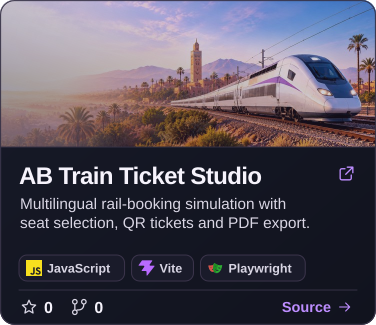
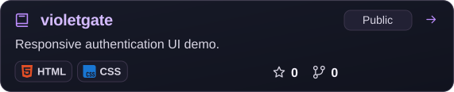
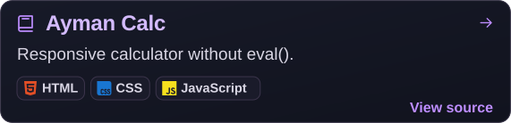

<!-- Generated by scripts/render_svg_cards.py --write-readme --live-technology -->

<picture><source media="(max-width: 680px)" srcset="./cards/hero-mobile.svg"></picture>

<a href="https://github.com/aymanbounaouj/aymanbounaouj/tree/profile-live/cards"><picture><source media="(max-width: 680px)" srcset="https://raw.githubusercontent.com/aymanbounaouj/aymanbounaouj/profile-live/cards/metrics-mobile.svg"></picture></a>

<a href="https://github.com/aymanbounaouj"><picture><source media="(max-width: 680px)" srcset="https://raw.githubusercontent.com/aymanbounaouj/aymanbounaouj/profile-live/cards/calendar-mobile.svg"></picture></a>

<picture><source media="(max-width: 680px)" srcset="https://raw.githubusercontent.com/aymanbounaouj/aymanbounaouj/profile-live/cards/technical-mobile.svg"></picture>

Language distribution (%)

<a href="https://github.com/aymanbounaouj/aymanbounaouj/blob/profile-live/live/portfolio.md#programming-languages">View code-byte breakdown ↗</a>

<picture><source media="(max-width: 680px)" srcset="https://raw.githubusercontent.com/aymanbounaouj/aymanbounaouj/profile-live/cards/tools-mobile.svg"></picture>

<picture><source media="(max-width: 680px)" srcset="./cards/heading-featured-mobile.svg"></picture>
 

 

<a href="https://aymanbounaouj.github.io/ab-train-ticket-studio/">AB Train Ticket Studio live demo ↗</a>

<picture><source media="(max-width: 680px)" srcset="./cards/heading-opensource-mobile.svg"></picture>
 

<a href="https://github.com/Egonex-AI/Understand-Anything/pull/794"><picture><source media="(max-width: 680px)" srcset="https://raw.githubusercontent.com/aymanbounaouj/aymanbounaouj/profile-live/cards/contribution-794-mobile.svg"></picture></a> 
<a href="https://github.com/OWASP/CheatSheetSeries/issues/2792#issuecomment-6633108162"><picture><source media="(max-width: 680px)" srcset="https://raw.githubusercontent.com/aymanbounaouj/aymanbounaouj/profile-live/cards/contribution-2792-mobile.svg"></picture></a> 
<a href="https://github.com/php/doc-en/pull/5930"><picture><source media="(max-width: 680px)" srcset="https://raw.githubusercontent.com/aymanbounaouj/aymanbounaouj/profile-live/cards/contribution-5930-mobile.svg"></picture></a>

More contributions

<a href="https://github.com/search?q=is%3Apr+is%3Apublic+author%3Aaymanbounaouj+-user%3Aaymanbounaouj&amp;type=pullrequests&amp;s=updated&amp;o=desc">All authored public external pull requests ↗</a> · <a href="https://github.com/search?q=is%3Aissue+is%3Apublic+author%3Aaymanbounaouj+-user%3Aaymanbounaouj&amp;type=issues&amp;s=updated&amp;o=desc">All authored public external issues ↗</a> · <a href="https://github.com/aymanbounaouj/aymanbounaouj/blob/profile-live/live/portfolio.md#verified-external-contributions">Verified merged PR inventory ↗</a>

<picture><source media="(max-width: 680px)" srcset="./cards/heading-building-mobile.svg"></picture>
 

<picture><source media="(max-width: 680px)" srcset="./cards/heading-pinned-mobile.svg"></picture>
 

 

<a href="https://github.com/aymanbounaouj?tab=repositories&amp;type=source&amp;sort=updated">More projects ↗</a>

<h3>Profile text and data sources</h3>

<strong>Ayman Bounaouj</strong> · Software Developer. Full-Stack Web Development. Building Practical &amp; Secure Digital Products.

<ul>
<li><a href="https://github.com/aymanbounaouj/morocco2030">Morocco2030</a>. Independent academic portal for multilingual tournament information and role-based staff workflows. <a href="https://github.com/aymanbounaouj/morocco2030/releases">Releases</a> · <a href="https://github.com/aymanbounaouj/morocco2030/actions/workflows/ci.yml">CI</a></li>
<li><a href="https://github.com/aymanbounaouj/ab-train-ticket-studio">AB Train Ticket Studio</a>. Independent booking simulation with sample tickets. <a href="https://aymanbounaouj.github.io/ab-train-ticket-studio/">Live demo</a></li>
<li><a href="https://github.com/aymanbounaouj/PC-Full-Check">PC Full Check</a>. Read-only Windows diagnostics and local reports. <a href="https://github.com/aymanbounaouj/PC-Full-Check/tree/main/tests">Tests</a></li>
<li><a href="https://github.com/aymanbounaouj/violetgate">VioletGate</a>. Authentication UI demo. <a href="https://aymanbounaouj.github.io/violetgate/">Live demo</a> · <a href="https://github.com/aymanbounaouj/ayman-calc">Ayman Calc</a>. Browser calculator. <a href="https://aymanbounaouj.github.io/ayman-calc/">Live demo</a></li>
</ul>

GitHub GraphQL supplies the <a href="https://github.com/aymanbounaouj/aymanbounaouj/blob/profile-live/cards/contributions.json">daily counts</a>. GitHub REST supplies repository totals and the <a href="https://github.com/search?q=is%3Apr+is%3Amerged+is%3Apublic+author%3Aaymanbounaouj&amp;type=pullrequests">merged public PR search</a>. <a href="https://github.com/aymanbounaouj">GitHub’s native contribution graph</a> shows current activity.

<a href="./docs/DASHBOARD.md">Technical evidence and refresh setup</a> · <a href="https://github.com/aymanbounaouj/aymanbounaouj/blob/profile-live/cards/technology.json">Technology evidence snapshot</a> · <a href="./PROFILE-V5.md">Original artwork and previous profile links</a>

© 2026 Ayman Bounaouj. Original AB branding. All rights reserved.

